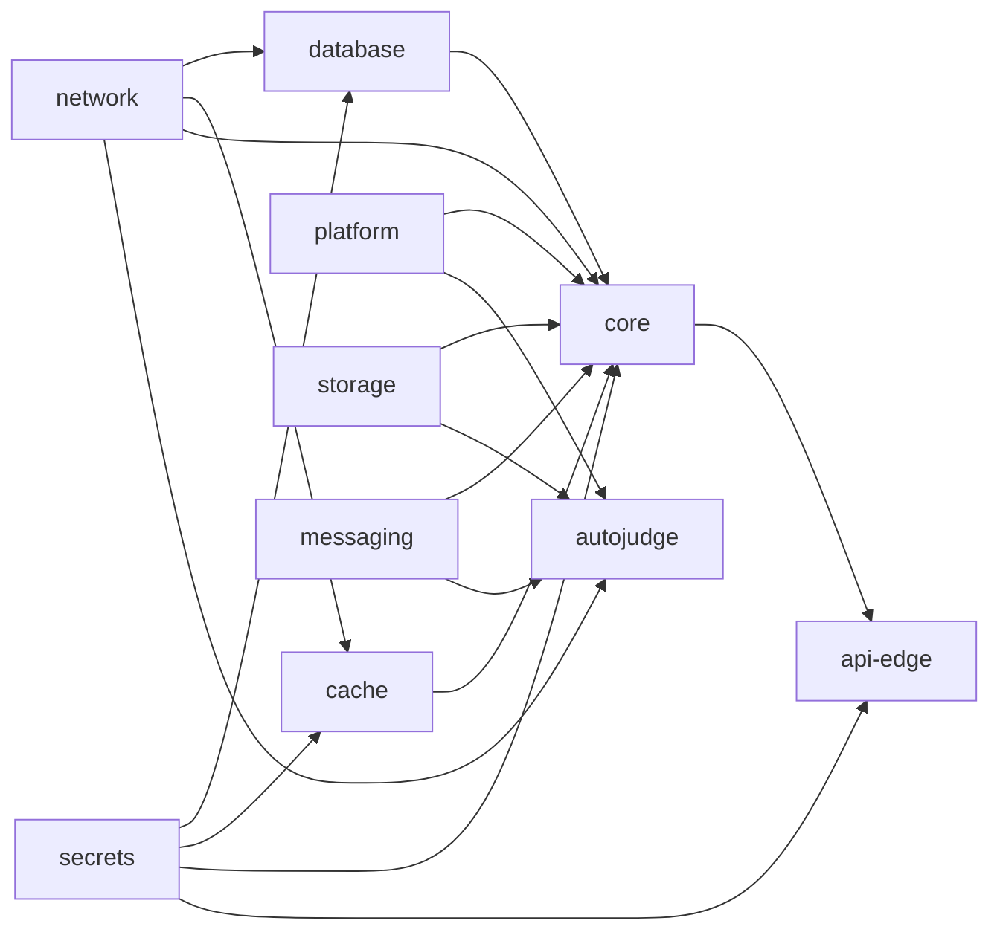

# Forseti infrastructure (AWS)

CloudFormation for the production and staging environments, split into small stacks so that several people can
work on it at the same time without stepping on each other. [`template.yaml`](./template.yaml) is the original
single-file template. It is kept untouched for reference and is no longer the one to deploy.

The goal of the design: **cheap while no contest is running, highly available and fast while one is.** One
parameter, `Mode`, switches the whole environment between the two (see [Idle and contest mode](#idle-and-contest-mode)).

## Stacks

Every stack is one file in [`stacks/`](./stacks) with one reason to change. Each environment (`production`,
`staging`) has its own copy of the stacks, named `<env>-forseti-<stack>`.

| Stack | What is in it | Typical owner |
| --- | --- | --- |
| [`network`](./stacks/network.yaml) | VPC, public and private subnets in two AZs, internet gateway, S3 gateway endpoint. No NAT gateway. | infra |
| [`secrets`](./stacks/secrets.yaml) | Generated secrets: database credentials, cache AUTH token, `root_password`, CloudFront origin check. | infra |
| [`platform`](./stacks/platform.yaml) | The two ECS clusters (core, judge), the OpenTelemetry collector on every instance, the SNS alarm topic. | infra / observability |
| [`storage`](./stacks/storage.yaml) | The Core S3 bucket (CORS for signed URLs, versioning, lifecycle). | core |
| [`messaging`](./stacks/messaging.yaml) | The SQS queues and dead-letter queues, DLQ alarms. | core / autojudge |
| [`database`](./stacks/database.yaml) | RDS PostgreSQL, parameter group, security group, alarms. | core |
| [`cache`](./stacks/cache.yaml) | ElastiCache for Valkey (sessions, leaderboard, SSE fan-out), alarms. | core |
| [`core`](./stacks/core.yaml) | Core API: ALB, origin certificate and DNS, instance fleet, IAM, task definition, service, alarms. | core |
| [`autojudge`](./stacks/autojudge.yaml) | Judge fleet, IAM, task definition, DAEMON service, queue-backlog scaling, alarms. | autojudge |
| [`api-edge`](./stacks/api-edge.yaml) | CloudFront distribution and DNS of the API. | infra / core |
| [`webapp`](./stacks/webapp.yaml) | SPA bucket, CloudFront, DNS, CloudWatch RUM. | webapp |
| [`shared/registry`](./stacks/shared/registry.yaml) | ECR repositories (`forseti/core`, `forseti/autojudge`). Once per account. | infra |
| [`shared/certificate`](./stacks/shared/certificate.yaml) | ACM certificate for CloudFront, **in us-east-1**. Once per account. | infra |

Stacks depend on each other only through CloudFormation exports (`<env>-<stack>-<Name>`), always in one direction:



The data stores own their security groups but have no rules in them: the stack of the client (`core`) opens the
port for itself. That keeps the arrows one-directional and lets a team change its own access without touching
anyone else's file.

### Working on it with several people

- One concern per file. A change to the CloudFront cache behavior touches `api-edge.yaml`; a new environment
  variable of Core touches `core.yaml`. They do not conflict, and each deploys on its own.
- A change to a stack only produces a change set for that stack. Releasing a new Core version never touches the
  database, the cache or the bucket.
- Do not export anything that CloudFormation replaces on every update (task definitions, launch templates):
  an export that is imported by another stack cannot change. The exports here are names and ARNs of long-lived
  resources.
- New backing service for Core? Create the stack, export its endpoint and security group, and let `core.yaml`
  open the port, as `database` and `cache` do.
- Optional, to require reviews per area, add entries like `/infrastructure/production/stacks/webapp.yaml @owner`
  to [`.github/CODEOWNERS`](../../.github/CODEOWNERS).

## Idle and contest mode

`Mode` is a parameter of `database`, `cache`, `core` and `autojudge`. Everything that differs between the two
modes is in a `Mappings` or `Conditions` block at the top of those files, so the sizes are easy to review and tune.

| | `idle` (default) | `contest` |
| --- | --- | --- |
| Core fleet | 1 × `t3.small`, 1 task. A deployment stops the task before starting the new one (short downtime). | 2 × `t3.small`, one per AZ, 2 tasks. A deployment keeps one task serving at all times. |
| Judge fleet | 0 instances. A waiting submission wakes it up in about 5 to 8 minutes; it shrinks again 30 minutes after the queue is empty. | At least 2 × `c6i.large`, one per AZ, up to 4 when submissions pile up. |
| Database | `db.t4g.micro`, single AZ | `db.t4g.small`, Multi-AZ with automatic failover |
| Cache | one node | primary plus replica in another AZ, automatic failover |
| Connection pool of Core | 10 max, 2 idle | 20 max, 5 idle |

Switching modes:

```bash
./deploy.sh production --mode contest mode     # about an hour before the contest starts
./deploy.sh production --mode idle mode        # after the contest ends (asks for confirmation)
```

Lead times: the database change takes 15 to 30 minutes (standby creation, and a reboot for the new instance
class), the cache replica about 10, a new instance 3 to 5. **Do not switch to idle while a contest is running.**
The database reboots for a few minutes in both directions, so do it well outside contest hours.

Staging is normally left in `idle`.

## Cost

Approximate on-demand list prices in us-east-2, for the default sizes. Check the AWS pricing pages before relying
on them.

| Idle, per month | |
| --- | --- |
| Application Load Balancer + 2 public IPs | ~$24 |
| Core instance (`t3.small`, 30 GiB gp3, public IP) | ~$21 |
| RDS `db.t4g.micro` + 20 GiB gp3 | ~$14 |
| ElastiCache `cache.t4g.micro` (Valkey) | ~$9 |
| Four secrets, alarms, logs | ~$4 |
| CloudFront, SQS, S3, ACM | free tier / cents |
| **Total** | **~$70 to $80** |

A contest adds about **$0.28 per hour** (second Core instance, two judges, bigger Multi-AZ database, cache replica,
public IPs): an 8 hour contest, including the hour of warm-up, costs roughly $2.50.

For comparison the original template cost about $95 or more per month while idle (NAT gateway alone is ~$33), with
no redundancy at all, and the Core consumers polled SQS without long polling (see below).

Watch the CloudWatch metrics bill: the applications export OpenTelemetry metrics through OTLP and CloudWatch bills
each distinct metric as a custom metric. Look at the number of metrics after a few days and add a `filter`
processor to the collector config in `platform.yaml` if it is high.

## First deployment

Needs the AWS CLI with credentials that can create the resources, and a Route 53 hosted zone for the domain.
Settings are in [`environments/`](./environments): region and domain, nothing secret. The hosted zone ID and the
certificate ARN are looked up by the script.

```bash
# 1. Once per account: ECR repositories and the CloudFront certificate (created in us-east-1)
./deploy.sh shared

# 2. Push the core and autojudge images to ECR, then bring the environment up with Core stopped
./deploy.sh staging --version latest --tasks 0

# 3. Apply the database migrations (see "Still open", item 1), then start Core
./deploy.sh staging --tasks default core
```

Core validates the schema when it starts (`ddl-auto: validate`) and nothing creates it yet, so it cannot be
healthy on a brand new database. That is what `--tasks 0` is for: everything else, including one Core instance
you can reach with SSM, comes up first. The same flag is useful later to stop Core while a migration runs.

Useful variants: `--dry-run` creates the change sets without executing them; naming stacks deploys only those
(`./deploy.sh production webapp`); omitting `--mode`, `--version` and `--tasks` keeps whatever the stacks already
run, so a routine deployment can never switch the mode by accident. Production stacks get termination protection.

The first run of an environment creates the `platform` stack (which owns the alarm topic) before the stacks with
alarms. Set `ALARM_EMAIL` in the environment file to be notified, and confirm the subscription email.

## Everyday operations

| Task | How |
| --- | --- |
| Release a new version | `./deploy.sh production --version <tag> core autojudge` |
| Start / end a contest | `--mode contest mode` / `--mode idle mode`, see above |
| Deploy the webapp | Build with the values printed by the script (`VITE_API_URL`, `VITE_CLOUDWATCH_RUM_*`), then `aws s3 sync dist/ s3://<bucket> --delete --cache-control "public,max-age=31536000,immutable" --exclude index.html`, upload `index.html` with `--cache-control "no-cache"`, and invalidate `/index.html` |
| Shell on an instance | `aws ssm start-session --target <instance-id>`. There is no SSH. |
| Update the AMI | The ECS-optimized Amazon Linux 2023 AMI is resolved on every deployment but running instances are kept. Roll them with `aws autoscaling start-instance-refresh --auto-scaling-group-name <asg>` (outside contests). |
| Read the root password | `aws secretsmanager get-secret-value --secret-id root_password --query SecretString --output text` |
| Delete an environment | Disable termination protection, the ALB and RDS deletion protection, then delete the stacks in reverse order. The Core bucket, the ECR repositories and the database snapshot are retained. |

## What changed from the original template

Findings while checking the template against the applications, and how they are fixed.

**Would not deploy**

- The CloudFront certificate was in us-east-2. CloudFront only accepts certificates from us-east-1
  (`shared/certificate.yaml`, deployed there).
- Route 53 records used `${Domain}` outside `Fn::Sub` and read the alias zone from a distribution attribute that
  does not exist. The `HostedZoneId` parameter held the constant of CloudFront's own zone and was never used.
- The task definitions set the container memory (1024 MiB) above the task-level memory (512 MiB), which ECS rejects.
- The cache used `ConfigurationEndpoint`, which belongs to Memcached, to get the Redis host.
- Both distributions had no cache policy, which CloudFront requires, and no origin request policy, so cookies,
  `Authorization` and `Origin` would not have reached Core even if the distribution had been accepted.

**Would deploy but not work**

- Core and autojudge had no task role: the S3, SQS, Scheduler and Secrets Manager permissions were on the
  execution role, which only the ECS agent uses. The applications would have been denied on every call.
- The database password was injected as a variable named `db_password` (the app reads `DB_PASSWORD`), from an
  RDS-managed JSON secret the execution role could not read, and `DB_USER` was missing.
- The Core profile enables TLS for Redis by default, but the cache had none. The cache now has TLS and an AUTH
  token. The SSE TTL and API port variables had the wrong names, and `Version` should have been `VERSION`.
- The ALB could not reach the instances (no rule for port 8080) while the instances accepted ports 80 and 443
  from the internet.
- Browser uploads to the signed URLs would fail the CORS check: the Core bucket had no CORS rules. The webapp
  bucket had no bucket policy, so every request was a 403 turned into `index.html` with status 200.
- The scheduler permission matched `<env>-auto-freeze-*`, but Core creates `auto-freeze-<id>`.
- The submission queue dead-lettered into `submission-failed-dlq` instead of `submission-failed-queue`, which is
  the queue Core consumes to mark a submission as failed (as `documentation/docs/architecture.md` describes).
- The autojudge could not write the execution details to S3.
- The root password secret had another name and a JSON body, while Core reads the secret `root_password` and
  compares the raw string.
- Staging reused the production aliases, cookie domain and CORS origin.
- The ECS-optimized Amazon Linux 2 AMI reached end of life on 2026-06-30.

**Cost, availability and latency**

- The SQS queues had no long polling and Core's consumers do not request it, so they looped on empty receives
  all day: at a few tens of milliseconds per call that is millions of requests per day. Long polling is now set
  on the queues (also lower latency, messages are delivered the moment they arrive).
- No NAT gateway (~$33/month): instances sit in public subnets, inbound closed except ALB to port 8080, no SSH,
  IMDSv2 only, and the private subnets of the data stores have no internet route at all.
- Core and the judge no longer share an instance: untrusted code runs on its own fleet and role, with CPUs that
  do not throttle, and the judge fleet scales with the submission queue and to zero when idle.
- The load balancer only accepts HTTPS from CloudFront (managed prefix list plus a secret header), and CloudFront
  talks to it over TLS, so passwords and session cookies never cross the internet in clear text.
- Health checks use the Spring Boot liveness probe, not the full health endpoint: a database or cache outage
  must not make the ALB and ECS kill healthy tasks and stretch the outage. A dead target is detected in about
  20 seconds and re-admitted in 20, instead of 60 and 150 with the default thresholds.
- CloudFront no longer caches 5xx answers, so users recover as soon as the origin does. HTTP/2 and HTTP/3,
  origin keep-alive and read timeouts are set for the SSE streams (heartbeat every 15 s).
- RDS: encrypted, 7 days of backups, storage autoscaling, slow query log, a self-managed password (RDS rotates
  managed secrets every 7 days while Core only reads the password at start, which would break the pools mid-contest).

## Still open: things outside this folder

These are not infrastructure bugs, but the system will not fully work until they are handled.

1. **Database migrations.** Nothing applies the Flyway migrations in production (the development compose file
   has a `migration` service, the Core image does not run Flyway), and Core cannot start without the schema. The
   simplest fix is to add `flyway-core` and `flyway-database-postgresql` to the Core runtime dependencies so it
   migrates on startup (Flyway's lock makes concurrent tasks safe). The alternative is a one-off ECS task or a
   pipeline step that runs the Flyway image with the SQL files before each Core deployment; the database is in a
   private subnet, so it has to run inside the VPC.
2. **Sandbox images.** The autojudge creates containers from `forseti-sb-<language>:<VERSION>` and does not pull
   them, so those images must already exist in the Docker daemon of every judge instance. Nothing builds or
   distributes them yet. A common approach is an ECR repository per image plus an init container (or user data)
   that pulls and tags them.
3. **Autojudge `/health`.** It calls `get_queue_url(QueueName=<queue URL>)`, which can only fail when the variable
   holds a URL (the worker needs a URL for `receive_message`), and `list_buckets`, which needs a permission the
   task role deliberately does not have. The ECS health check therefore only verifies that the HTTP server answers.
4. **Autojudge batching.** The worker receives up to 10 messages with a 60 second visibility timeout and judges
   them one by one. One worker holds a batch while other judges idle, and a slow batch makes messages reappear and
   be judged twice. `MaxNumberOfMessages=1` fixes both and is what makes several judge instances actually help.
5. **`root_password`** is the hard-coded name of the secret in `SignInService`. Staging and production can only
   share an account and region if the name becomes a setting, or if staging runs in another account.
6. **Webapp RUM** does not pass `identityPoolId` to the client, so events cannot be authorized, and it samples
   100% of sessions (RUM costs about $1 per 100k events).
7. **Deployment workflows** (`deploy-staging.yaml`, `deploy-production.yaml`) build and push the images, run
   `deploy.sh <env> --version <tag> --yes` (the mode is preserved), then build and upload the webapp. They need
   the `AWS_ROLE_ARN` secret and the `forseti-registry` stack deployed beforehand. They cannot do the first
   deployment, which needs `--tasks 0` and a manual migration (see above).
8. **Cookies on staging.** Staging lives under the production domain, so a production cookie scoped to
   `forsetijudge.com` is also sent to `staging.forsetijudge.com`. A separate domain for staging avoids it.

## Using a NAT gateway instead

If you prefer private subnets for the instances, add a NAT gateway and an `0.0.0.0/0` route in the private route
table of `network.yaml`, and point `VPCZoneIdentifier` of both fleets to the private subnet IDs. It costs about
$33 per month plus data processing, and the NAT gateway is a single-AZ dependency unless you add one per AZ.
